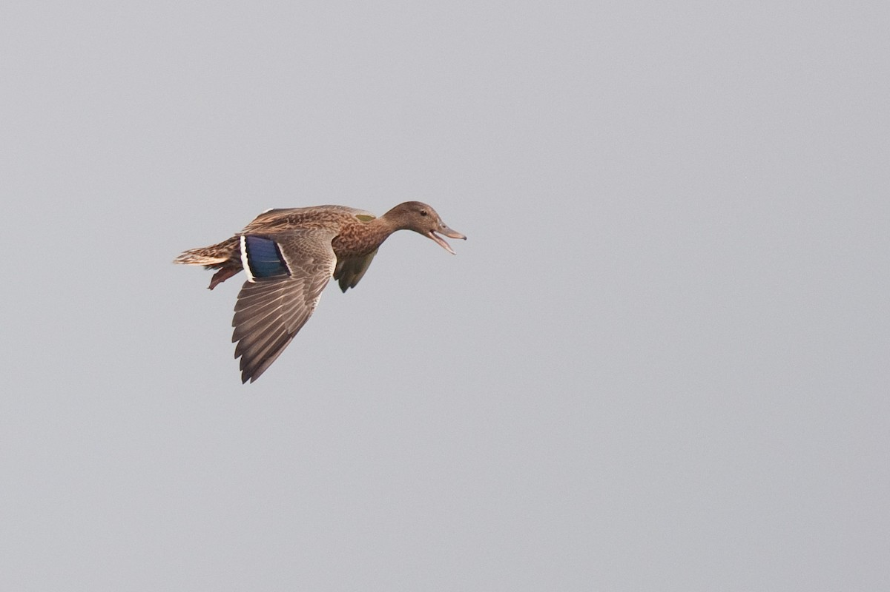

# koloa

**K**eplerian **O**rbits **L**ifted from **O**utlier-**A**ffliction.

[](https://ebird.org/checklist/S24309944)

The koloa is the Hawaiian duck. The package puts the duck test to a radial
velocity signal (does it look, swim and quack like a planet?), and it does so
on data in which some exposures, or whole visits, cannot be trusted.

Every tool in koloa is outlier-aware in the same way. The noise is a mixture:
each exposure, and each visit as a whole, is either good or an outlier whose
variance is inflated by a width W. The indicator of which it is gets summed
over, or sampled; no clip ever decides it. Because the likelihood is Gaussian
given the indicators, every linear parameter (offsets, trends, decorrelation
terms and the amplitudes of circular orbits) can still be integrated out
exactly. That is what makes the outlier-aware FIP affordable.

## What is in the package

| module | what it does |
| --- | --- |
| `koloa.data` | `RVData`: velocities with their instruments, visits (sequences) and activity indicators; reads LBL `.rdb` and csv files |
| `koloa.fip` | the **outlier-aware false inclusion probability (OAFIP)**: the Hara et al. (2022) FIP periodogram with up to `kmax` signals, a visit jitter and point or visit outliers; also the single-signal FIP with a fixed noise (fast, Hara-comparable) and the soft- and hard-clip versions, side by side |
| `koloa.periodogram` | GLS, the **outlier-aware periodogram (OAP)** (profile likelihood with the mixture), leave-one-visit-out jackknife, window, aliases |
| `koloa.fit` | `RVModel`: any number of orbits (circular or eccentric; transiting planets with ephemeris priors), a GP (SHO, rotation, quasi-periodic, SE, Matern-3/2), per-instrument offsets and jitters, a visit jitter, and gaussian, Student-t or mixture noise, all fitted **jointly**; MAP with a Laplace covariance, and MCMC. `mcmc_orbits` goes from a series to the posterior of the orbital elements in one call, and runs until the chain holds 50 autocorrelation times |
| `koloa.diagnostics` | coherence of amplitude and phase through the campaign, activity indicators at P, 2P and 3P, eccentricity at the prior edge, absorption by a GP, and `duck_test`, which runs them all |
| `koloa.plotting` | every point coloured by its outlier probability (blue reliable, grey undecided, red outlier, and hollow when more likely an outlier than not); phase folds with binned means and a 1-sigma envelope; per-visit views; periodograms side by side; corner plots that overlay several posteriors, one colour each; in the detailed report, the series has a colour per instrument, each set about the drift of the star (its median taken along the trend of the fit, not about zero), the points translucent and circled when more likely outliers than not |
| `koloa.simulate` | series with known planets, activity and realistic outliers: single spikes, bad visits, flares and heavy tails, clear or borderline (`CLEAR`, `BORDERLINE`, `REALISTIC`), drawn on a real observing window when one is given |
| `koloa.completeness` | recovery rates on a grid of period and K: planets injected into a series and looked for by folding it at their period with the outlier-aware likelihood (or a blind search), with the false-alarm rate measured at K = 0 |
| `koloa.secular` | the acceleration of a star in both senses of "secular acceleration": `acceleration(fit)` reads the trend of a fit as the acceleration of the star (m/s/yr) and its change (m/s/yr^2), with their errors; `companion_min_mass(accel, distance, separation)` gives the smallest companion that makes it (Torres 1999); and the perspective acceleration mu^2 d from the Gaia DR3 astrometry, with its error propagated from the covariance of the proper motions and the parallax, which `RVModel(perspective=(value, error))` fits as a parameter with that prior (only for velocities whose barycentric correction did not remove it; APERO's did) |
| `koloa.outliers` | why an outlier is an outlier: `explain_outliers(fit)` compares every outlier (a whole visit, or a single exposure) with the good data on everything recorded with it, the header keywords of LBL files (smart lists for SPIRou and NIRPS: S/N, airmass, telluric absorption, the shape of the image, the Fabry-Perot, the age of the wavelength solution...), DACE's columns for HARPS and ESPRESSO, the activity indicators and the error bars; which keys are significantly off for each outlier, and which the outliers share |
| `koloa.dace` | the public velocities of a star on DACE, every instrument, one instrument per era, with every column kept |
| `koloa.gui` | koloa in the browser (`koloa --gui`): a SIMBAD resolver, the velocities by instrument, the gathering and the detailed report, each run shown as the command line it is |
| `koloa.gather` | everything public about a star from its SIMBAD name, kept in one folder: the velocities of DACE and of CARMENES DR1, the TESS light curves, the identifiers and periods of variability of SIMBAD, and a manifest of what each archive gave |
| `koloa.datasets` | which datasets of a star are used: a spectrum that several have (HARPS on DACE and by SERVAL, HIRES in three surveys) is taken from the most precise release, told by the noise of each on the spectra they share; a dataset that constrains neither the mean nor the slope of a line through the nightly means is left out; everything stays on disk and can be asked back |
| `koloa.survey` | a survey: the stars of SIMBAD within a distance and a range of spectral types, which of them have velocities in the archives (DACE, CARMENES DR1, the surveys on VizieR), the files of velocities one has of them (LBL, through APERO's names), and their batch: run here, or packed as one folder and its tar (the files, the archives, koloa itself, a script whose first setting is where the folder is) for a server or a cluster |
| `koloa.batchpdf` | the summary of a batch: how the quick look of each star reads (a candidate, a known planet, the rotation, a drift), a page for each star, and one PDF of them all, from what the batch kept |
| `koloa.prospects` | what more data would do for a candidate: the error of K with 50 to 200 more nights of an instrument over 6 months to 2 years (the nights it can be observed from its site, a Fisher forecast scaled to today's error), and its astrometric signal against the precision of Gaia DR4 |
| `koloa.archive` | the names of a star (CDS Sesame) and its planets in the NASA Exoplanet Archive, with every published solution; a fitted K against them, the most recent first |
| `koloa.radvel_bridge` | `OutlierRVLikelihood`, a drop-in replacement for radvel's `RVLikelihood` |
| `koloa.doppler` | relativistic Doppler conversions (velocity, wavelength ratio, log-wavelength shift) |
| `koloa.analyze` | all of the above on one series, with a report and figures |
| `koloa.detailed` | `detailed_analysis`: everything koloa can say about a star from one file, with its known planets (archive), more data (DACE, the velocities published with its planets on VizieR, and any given), the FIP in two passes, the known planets tested at their periods, a GP of the activity, the activity indicators and why each outlier is one, as a LaTeX/PDF report |
| `koloa.literature` | published velocities: a VizieR .dat or csv file read (times to BJD - 2400000, km/s to m/s), and the tables of the papers of a star's planets found on VizieR from their bibcodes |
| `koloa.apero_names` | APERO's names of stars (SPIRou, NIRPS): a copy of APERO's astrometric database (streamed from its assets server), names looked for as APERO does, the star of a file (its OBJECT column or its LBL name) and its SIMBAD name |
| `koloa.transit` | a transit in the TESS light curve at the period of a velocity signal or a TOI: high-passed (the transits found left out of the trend), folded, a box searched about the expected conjunction (its error carried to the epochs of TESS) or over the whole phase, the period scanned within 3 sigma when its error would move a transit by more than half a duration over the span of TESS; plausible at 7 sigma in 2 transits or more, not from one event, beyond the best box at the periods of a null where there is nothing and with a chance below 1 % of the null reaching it; depth, radius, the depths of 1 Earth and 1 Jupiter radius before the star |
| `koloa.kit` | the analysis kit of a star (the GUI's Analysis script): a commented script of the analysis calling koloa's routines, its settings from the page, with the velocities, the archives and the star (YAML) in one .tar.gz that runs offline |
| `koloa.tng` | the velocities of the pipeline of HARPS-N from the archive of its telescope (the TNG, at the IA2): a star found by where the telescope was pointed (`pointings`, `near`, `files`), the headers of its public CCF files read and kept in a table (`exposures`, with a tqdm bar), and its two reductions (3.7 and espdr) as two datasets of the same spectra (`series`, `velocities`); a source of `koloa.published` |
| `koloa.shared` | the velocities of HARPS-N that koloa's users fetched, shared in a repository (koloa-harpsn): the table of a star read before the archive (`rows`, `index`), and a star asked to be added after its files were fetched (`request`: only when you share, with `gh auth login`, never for the names you keep apart) |
| `koloa.lblbatch` | LBL for many stars on a server: a package (`koloa STAR... --lbl-pack INST...`, the Batch LBL tab) with the list of the spectra the archives have of each star and their size (`fetch_list.csv`), their archives, koloa, and `run_lbl.py`, which fetches the spectra there, runs LBL, adds the rdb to koloa-rvs and runs koloa's batch on them (`--check`, `--part i/N`, `--merge`); `--fetch` carries the spectra of one star in it |
| `koloa.rvstore` | the team's private repository of velocities (koloa-rvs, for its collaborators): what it has of a star copied into its folder before the archives are asked (`pull`), what you gather added to it when you choose to (`push`, `push_all`; `koloa --rvs-push archives`), never a star you keep apart; through `gh`, with no copy of the repository |
| `koloa.lblrun` | LBL velocities from the public spectra of the archives: the spectra of a star fetched (HARPS-N: the espdr S2D_A of the TNG, of the exposures `koloa.tng` keeps), and lbl-rapide (the faster branch of LBL) run on them with a Python of its own, in a process of its own; the rdb kept in the folder of the star (`lbl_star`; `koloa "GJ 436" --lbl HARPSN`, the LBL tab of the GUI) |
| `koloa.observatories` | the velocities of the pipelines of the other spectrographs, from the archives of their observatories, each asked with no account: HARPS (the catalogue of its velocities), ESPRESSO and NIRPS at ESO (`eso`), NEID at NExScI (`neid`), SOPHIE and ELODIE at the OHP (`sophie`, `elodie`; the errors of ELODIE from Perrier et al. 2003), SPIRou at the CFHT (`cfht`, the CCF of APERO at the CADC); each dataset says whether it still holds the perspective acceleration and whether it defers to a file of the same spectrograph; sources of `koloa.published` |
| `koloa.published` | the velocities published for one star on VizieR: the surveys (Keck HIRES to 2023, Teklu et al. 2025, and Tal-Or et al. 2019; the California Legacy Survey's HIRES, APF and Lick Hamilton, Rosenthal et al. 2021; the Lick Hamilton of Fischer et al. 2014; HARPS by SERVAL, Trifonov et al. 2020), the star found by its position in their lists of stars (kept on this machine), then the tables of the papers SIMBAD lists for it; each source its own offset, a spectrum published twice kept once |
| `koloa.gpcheck` | the signals against a GP of the activity (its prior the rotation period of the archive): the likelihood each adds, periodograms whitened by the GP with false-alarm levels from simulations of its noise, and the whole series with the GP |
| `koloa.latex` | the detailed analysis as a LaTeX report, compiled to PDF by pdflatex |

## Install

koloa needs numpy, scipy and matplotlib. emcee (for posteriors), radvel (the
bridge and cross-checks), astropy and threadpoolctl are optional and are
imported only when used.

```
git clone https://github.com/eartigau/koloa.git
cd koloa
pip install -e .            # the package and the `koloa` command
pip install emcee radvel    # optional: posteriors, radvel bridge
```

## Use

From the command line, on an LBL `.rdb` (rjd, vrad, svrad and the indicators):

```
koloa data/kepler21_harpsn_dace_drs3.3.12.csv --outdir kepler21 --kmax 3
```

This writes periodograms, FIPs, a fit, the duck test and every figure into
`kepler21/`, with a text report and a JSON summary.

The detailed analysis goes further, from one LBL `.rdb`, from the SIMBAD
name of the star, or (best) from both:

```
koloa star.rdb --detailed --target "GJ 436" --outdir star
koloa spirou.rdb nirps.rdb harps.rdb --detailed --target "GJ 436" --outdir star
koloa --detailed --target "GJ 436" --dace --carmenes --outdir star  # the archives only
```

Each file is one or more instruments, named from its own columns (the
names of its files: HARPS03 or HARPS15 on either side of the 2015 upgrade,
ESPRESSO18 or ESPRESSO19, NIRPS, HARPN; SPIRou from APERO's keys), or as
`--instruments SPIRou NIRPS auto` says; one already in an earlier file is
named `<inst>_<k>`, and one that DACE has too is `<inst>_DACE`, each with
its own offset, the same spectra never counted twice.

It finds who the star is (SIMBAD: the name given, or a guess from the
file's OBJECT column), its known planets in the NASA Exoplanet Archive
(every published solution), and, only when asked, more velocities: what DACE has of the star
(`--dace`: every other instrument, merged with the file; DACE answers from
some networks only, and the analysis goes on without it; a key in
DACE_API_KEY or ~/.dacerc adds what its account may see), CARMENES DR1
(`--carmenes`, corrected for the nightly zero points) and the velocities
published on VizieR (`--vizier`: the surveys of Keck HIRES, the APF, the
Lick Hamilton and HARPS by SERVAL, the tables of the star's papers and of
its known planets). Without them, the report
uses the files alone. The orbits are fitted
with a trend in time in the likelihood, the acceleration of the star,
reported in m/s/yr with its errors and drawn with the model
(`--no-trend` not to, `--curvature` for its change too). `--toi` fits
the TESS Objects of Interest of the star with the ephemerides of TESS (its
period and the time of a transit as gaussian priors, K free, its fold at
the phase of the transit), whether the FIP finds them or not: all of them
but the false positives, or the ones named (`--toi 175.01 175.02`). Then the FIP of every instrument together in
two passes (the errors of each instrument inflated to its noise, first
without planets, then with them), the signals fitted together and set
against the known planets, the activity indicators, the duck test, and why
each outlier is one. It runs on the nightly means, with a GP of the activity
inside the FIP (one per instrument, by period band, only as flexible as the
data ask for), and decides planet or no planet on the period or any of its
aliases. On request, a detection map (which planets the series could have
found): `--detection-map` looks for injected planets with the FIP and the
GP, the rule that decides (hours on a long series); `--search-map` with a
quicker blind periodogram search. From Python:
`koloa.detailed_analysis('star.rdb')`.

Beyond the FIP's signals, the known planets are tested at their periods,
and so are the periods given (`--periods 113.46`, a candidate the archive
does not list). The velocities published with the known planets are
fetched from VizieR with `--vizier` (from the bibcodes of their solutions
in the archive), and published velocities can be given
(`--literature paper_rvs.dat`: a VizieR .dat, or a csv or .rdb with named
columns); a published velocity within a minute of an exposure of the file
is the same spectrum and is left out. The signals are fitted again with a
GP of the activity (the rotation period of the archive as its prior, a
free period otherwise): the likelihood each adds over the GP, periodograms
whitened by the GP with their false-alarm levels, and the whole series
with the GP overplotted, season by season (`--no-gp` not to). Everything
goes into `<star>_report.pdf`, a LaTeX report compiled by pdflatex when
there is one (`<star>_report.tex` otherwise; `--no-latex` for neither):
the star, the data and where they come from, the known planets and their
published solutions, the FIP, the signals against the known planets
(their K and the published ephemeris carried to the data), the GP, the
duck test of each signal, the activity indicators and the rotation, the
outliers, and every figure.

`koloa "GJ 436" --gather archives` gathers what is public about a star
from its SIMBAD name, in `archives/GJ_436`: the velocities of DACE (one
file per instrument era, with the indicators), those of CARMENES DR1
(corrected for the nightly zero points, through GAVO's TAP service), the
velocities published on VizieR (`rv/published/`, `koloa.published`: the
surveys of Keck HIRES, the APF, the Lick Hamilton and HARPS by SERVAL,
asked only when the star is in their lists, the tables of the star's
papers, and the velocities of the pipelines from the archives of the
observatories: HARPS-N read in the headers of the public CCF files of the
archive of the TNG (`koloa.tng`, in its two reductions), NEID, SOPHIE
and ELODIE at the OHP (`koloa.observatories`), with the width, the
contrast and the bisector span of their CCFs as indicators where the
archive gives them. Two more only when they are named
(`--vizier-sources ... eso cfht`, or their boxes in the GUI): HARPS,
ESPRESSO and NIRPS at ESO, which has what DACE has, and SPIRou at the
CFHT, whose archive takes half an hour for a star observed often. Each
source is kept whole; the velocities
of a CCF in the near infrared (SPIRou at the CFHT, NIRPS at ESO) are left
out when you give a file of that spectrograph; `--no-vizier` not to,
`--vizier-sources teklu25 cls21 papers` for some of them only), the
TESS light curves of every sector, every velocity of DACE and CARMENES together in
`rv/all_rv.csv`, the identifiers and the periods of variability SIMBAD
lists in `target.json`, and what each archive gave (or why not) in
`manifest.json`. From Python, `koloa.gather.gather('GJ 436', 'archives')`,
and `koloa.gather.load('archives/GJ_436')` reads it back. DACE is filtered
from some networks: it is then reported as unreachable and the rest goes
on. Every archive is asked at once, not one after the other: the slowest
sets the time.

LBL can be run on the public spectra of the archives too (`koloa.lblrun`,
the LBL tab of the GUI): `koloa "GJ 436" --lbl HARPSN SOPHIE SPIROU NIRPS
ESPRESSO` fetches the star's spectra and runs lbl-rapide on them with a
Python of its own (an environment called lbl-rapide by default;
`--lbl-python`), each rdb kept as `archives/GJ_436/lbl/GJ_436_<inst>_lbl.rdb`,
a file per dataset koloa knows, to be given as a file. The spectra: the
espdr S2D_A of HARPS-N at the TNG (of the exposures koloa keeps from their
CCFs), the e2ds of SOPHIE at the OHP (HR and HE apart; SOPHIE and SOPHIE+
two datasets), APERO's t.fits of SPIRou at the CADC (a reduction LBL does
not read left out), the S2D of NIRPS at ESO divided by ESO's model of the
telluric lines (HE and HA apart), and the S2D_A of ESPRESSO at ESO
(ESPRESSO18 and ESPRESSO19 two datasets), each file of ESO's tars fetched
alone by Range requests; another target pointed at nearby (the companion
of a binary, named as another star of a catalogue the star is in) is
left out. In the near infrared, a star whose
spectra span less than 10 km/s of BERV uses the template of GJ 699
(`--template` names another): its own would keep the residuals of the
telluric lines. The spectra go in `--lbl-dir` (a few GB a star); those
already there are neither fetched nor computed again. LBL puts each
spectrum at rest with the BERV of its pipeline, so its velocities hold
the perspective acceleration of the star as the pipeline's do: those of
ESO (HARPS-N at the TNG, NIRPS, ESPRESSO) and of SOPHIE do, APERO's do
not. It is taken out of the files koloa keeps (from the Gaia astrometry
of the star, said in `perspective.json` beside them), which are then on
the footing of APERO's: the 196 velocities of HARPS-N of Barnard's star
(2013 to 2020) drift by 4.94 m/s/yr as LBL gives them, where 4.54 is
expected, with an rms of 11.6 m/s; by 0.40 m/s/yr once it is taken out,
with an rms of 2.4 m/s.

| | spectra | fetched | LBL | median error | rms | the CCFs of the same spectra |
|---|---|---|---|---|---|---|
| HARPS-N, Gl 408 | 51 | 2 min 43 s | 5 min 31 s (models fetched) | 0.72 m/s | 2.16 m/s | 1.10 m/s, 2.66 m/s |
| SOPHIE+, Gl 687 | 76 | 1 min (88 with SOPHIE) | 2 min 34 s | 1.40 m/s | 5.90 m/s | 1.45 m/s, 6.23 m/s |
| ESPRESSO19, GJ 1002 | 57 | 9 min (3.6 GB) | 3 min 55 s | 0.38 m/s | 2.08 m/s | 0.60 m/s, 2.27 m/s (DACE) |
| SPIRou, TOI-1452 | 210 | 11 min (3.7 GB) | 42 s (template of GJ 699) | 7.0 m/s | 11.2 m/s | 13.8 m/s on 18 of them |
| NIRPS, GJ 699 | 70 | 6 min (1.7 GB) | 2 min 10 s | 1.66 m/s | 3.5 m/s (a line out) | |

For many stars, or a star whose spectra are too large for this machine,
`koloa "Gl 408" "GJ 1002" --lbl-pack HARPSN SOPHIE ESPRESSO --pack-name
lbl_two --server-root /scratch/me/lbl_two --server-lbl-python
/path/to/lbl-rapide/python` makes a package to run on a server (the Batch
LBL tab does the same): here, only the list of the spectra and their size
(`fetch_list.csv`), the archives of the stars and koloa; there, `python
run_lbl.py --check`, then `python run_lbl.py`, which fetches the spectra,
runs LBL, adds the rdb to the team's repository and runs koloa's batch on
them (`results/summary.pdf`). Tried here on those two stars: 9 min, the
rdb of HARPS-N, SOPHIE, SOPHIE+ and ESPRESSO used by the batch under
their names. `--fetch` carries the spectra in the package (the LBL tab's
Fetch the spectra and prepare a package).

The archives of a star often hold the same spectra more than once
(HARPS through the ESO pipeline on DACE, through SERVAL on VizieR, in a
paper with a reduction of its own), and old velocities too imprecise to
constrain anything. Everything is kept on disk, and `koloa.datasets`
chooses what an analysis uses, the same way in the report, the GUI, a
batch and the analysis script:

1. A spectrum that several datasets have is taken from the most precise
   of them. On the spectra two releases share, the star does the same in
   both: their difference is noise alone, and the covariance of each with
   that difference is its own noise, with no model of the star (its
   strongest signals are taken out of both first, only to sharpen the
   comparison; a release binned by night is compared bin for bin). When
   the noises cannot be told apart: a dataset that names its spectrograph
   before a table that names none, then the latest release, then the one
   with the more spectra. A release left with fewer than three spectra of
   its own is left out; one that has spectra the better release lacks
   keeps those.
2. A dataset that constrains nothing is left out: a line is fitted to the
   nightly means (an offset per dataset, one slope), and a dataset is
   dropped when taking it away makes the error of the mean and that of
   the slope grow by less than 1 %, the weakest first. The error of a
   night holds what the star does about a line (the same for every
   instrument), so a few nights among hundreds weigh little whatever
   their precision.

The datasets of a file you give are never left out. `--exclude` leaves
datasets out, `--include` asks back those the rules would leave out (a
release asked back is preferred to the others for the spectra they
share), `--no-rules` keeps every dataset (a spectrum is still used once).
From Python, `koloa.datasets.choose(data, sources)` gives the series used
and what was done with each dataset, and `koloa.datasets.told(row)` says
it in words.

`koloa --gui` (or `koloanui`, the same in one word) does the same in the
browser, from this machine: a SIMBAD
resolver (identifiers, position, TIC, the rotation periods SIMBAD and
CARMENES list), the velocities of a file and of the archives by instrument,
and the gathering and the detailed report with their options. Every run is
the koloa command line the page shows, word for word (copy it for a
batch), in a process of its own; its steps show as they go, with the time
each took, its log, and the report when it is done. The page is served on
127.0.0.1 only and runs nothing but koloa. Every field has an (i) that
explains it in full: what it does, what to enter, its default.

Its Survey tab starts from constraints instead of a star: a range of
spectral types and a distance (M0 to M9 within 15 pc, say) asked of
SIMBAD, a table of the stars (each with the rotation periods SIMBAD
lists, and that of CARMENES DR1), a button that cross-matches them with
the archives and says which have velocities, spectrograph by
spectrograph (a tick shows only those with some data), your folders of
LBL files matched to them by name, and the batch of those ticked: run in
the page, or packed for another machine. The sources (DACE, CARMENES DR1,
each survey on VizieR, the papers, each archive of an observatory) have a
tick each, the same for the cross-match, the batch and the pack. From
Python:

```python
from koloa import survey
stars = survey.sample(sptype=('M0', 'M9'), dmax=15.0)        # SIMBAD
survey.check(stars, 'archives')            # DACE, CARMENES DR1, surveys,
                                           # archives of observatories
# or some of them: sources=['teklu25', 'tng', 'neid'] (koloa.published.SOURCES)
survey.match_files(stars, ['/data/nirps/lbl', '/data/spirou/lbl'])
ticked = [star for star in stars if survey.has_data(star)]
made = survey.pack(ticked, 'm_dwarfs_15pc', root='archives',
                   server_root='/scratch/me/m_dwarfs_15pc')
```

`pack` writes one folder and its `.tar.gz` with everything the batch
needs and no path of this machine: the files of each star, its archives
(gathered first, so that nothing is asked of the network there), what
koloa fetched once (`KOLOA_CACHE` names where koloa keeps it), koloa
itself, and `run_batch.py`. The first setting of that script is `ROOT`,
where the folder is on the machine that runs it; there, `tar xzf`, then
`python run_batch.py` (several stars at once; `submit.sh` is the same as
a SLURM job array). Each star done is kept in `results/` (its line of
the table, its FIP, a PDF), so a batch stopped goes on where it was, and
the results brought back open in the page as a batch.

The tar is copied and run outside koloa, and its `README.txt` says the
whole of it, for a person or for a Claude session on that machine: how to
copy it, what it needs (Python 3.9 or later with numpy, scipy and
matplotlib, no network), `python run_batch.py --check` (nothing computed:
is everything there, and where is the batch: each star done, failed,
being computed and how far, or to do), `--stop` (the processes of this
batch, and no other), how long stars took, how to bring `results/` back,
and what each column of the table is. Once a batch is packed, the page
says where its tar is on this machine, in full.

Each star of a batch has a page of summary, the first of its PDF
(`koloa.batchpdf`): a verdict (a candidate: a peak below the FIP limit
that is neither a known planet nor a drift; known planets; a drift;
nothing), each peak with what it is (a known planet, the rotation of the
star or a harmonic, a year), its FIP, its folds, its velocities, its
datasets. `results/summary.pdf` is the batch in one PDF, the candidates
first (`python run_batch.py --summary`, or Summary PDF in the page, make
it again from what is done). With the report option (a tick of the Survey
tab, `REPORT` in the script, `survey.run(..., report=True)`), a star that
has a candidate has its detailed report too, on the series its quick look
used, whatever it came from; the GP of its FIP is an SHO at the rotation
period when one is published, a local GP by period band otherwise.

A candidate also has its prospects (`koloa.prospects`), a page of its
own: what 50, 100, 150 or 200 more nights of the instrument of its files
(SPIRou, NIRPS...) would do for K over its error, spread over 6 months, a
year or two on the nights the star can be observed (the candidate taken
as real, the mean error bar of the instrument, the bright half of the
lunations for SPIRou), and its astrometric signal, at least, against what
Gaia DR4 measures: the noise of one crossing at its G magnitude, the
crossings it has, and its significance there, as the chi2 the planet
lowers against the 50 a detection asks for (Lammers & Winn 2025). Orders
of magnitude, to plan with.

Its plot is a quick look before the report: the velocities shown, with
sliders on both axes, and under them a quick FIP of exactly what is shown
(outlier-aware, the period alone and the period or any of its aliases
overplotted, no GP, in the two passes of the report, about a minute), the
window (a day, a synodic month, a year) dotted and the known planets
dashed; its PDF button writes both, as they are shown. Under the FIP, the
periodograms of the same series (not FIPs; `koloa.periodogram.gls_offsets`,
a sinusoid with an offset per dataset): the velocities, their window
function and each activity indicator the series has, a tick each; with
several datasets, each one's in its colour under the joint one; the
nights the quick FIP holds for outliers left out; the false-alarm levels
(approximate), a day, a month, a year, the peaks of the FIP, the known
planets and the candidates of TESS dotted; zoomed with the FIP.

The report's card has an Analysis script button: a kit (a .tar.gz) to run
the analysis yourself, offline, and change it. Its `analysis.py` calls
koloa's routines step by step (the velocities read and put together, a fit
of their noise, the FIP in two passes, the Keplerian orbits of the signals
with their errors and minimum masses, the acceleration of the star, the
folds, the FIP of the residuals), each step explained at length in its
comments (in English or in French, the page's language), its figures saved
as PDF; beside it, the files of velocities, the archives gathered for the
star, and `star.yaml` (and `star.json`), what SIMBAD, the NASA Exoplanet
Archive and TESS say of the star. Its settings are those of the card.

The star of a file is found by its APERO name when no SIMBAD name is
given (`koloa.apero_names`): its OBJECT column (LBL keeps the header key
of each spectrum), else its name (`lbl_<OBJECT>_<TEMPLATE>.rdb`, or
`<OBJECT>_rv_....rdb`), looked for in APERO's database of names exactly
as APERO looks (the same cleaning of the name, the same variants, its
aliases), which gives its SIMBAD name; the page fills the star from it,
and the report uses it. The database is a copy of the astrometrics folder
of APERO's assets: its YAML files come first in the tarball of APERO's
assets server, so the copy streams a few MB and stops (no APERO needed);
made at the first lookup, again with `koloa --refresh-apero` or the
page's Refresh APERO names (`KOLOA_APERO_ASTROMETRICS` points to a folder
of one's own instead; reading it needs PyYAML, `pip install pyyaml`).

The Batch FIP tab runs the quick FIP of many files: the object of each
(its APERO name) in the table, and with every archive ticked, each star's
archives (DACE, CARMENES DR1, VizieR) gathered and put with its file, the
nights of each instrument in the table; a best peak with a FIP below 10 %
is looked for in TESS (the star's light curve, high-passed and folded at
its period, about the conjunction of its fold: `koloa.transit`), and a
plausible transit flagged. The Analysis tab shows the same search for
each peak below 10 % (a transit found would make a weak signal strong)
and each TOI or transiting planet of the star: every
point, their medians in bins, the box found, and the depths of a 1 Earth
and a 1 Jupiter radius planet before the star (its radius the best guess:
the NASA Exoplanet Archive, the TESS Input Catalog, APERO, the spectral
type). Tested on LHS 1140 b and c, TOI-700 b, c, d and e and GJ 436 b,
found at their radii, and at periods where there is nothing; a star as
active as AU Mic makes dips of its own at any period, and is said to.

From Python:

```python
import numpy as np

import koloa

data = koloa.RVData.from_csv('series.rdb', name='My star')

# koloa's analyses (oafip, duck_test, analyze, detailed_analysis) run on the
#   nightly means by default (RVData.nightly: one point per night and
#   instrument); nightly=False, koloa.data.NIGHTLY = False or the environment
#   variable KOLOA_NIGHTLY=0 keeps the exposures
# the outlier-aware FIP, up to three signals
fip = koloa.oafip(data, kmax=3, outliers='both')
# with a GP of the activity inside the FIP (a finite basis whose weights are
#   integrated out, its hyperparameters sampled with the jitters): a local,
#   non-oscillating one, or a rotation one with a prior on its period
fip = koloa.oafip(data, kmax=3, gp='local')
#   (a gaussian on ln P_rot: 116 d, 10 %)
fip = koloa.oafip(data, kmax=3, gp=dict(kind='rotation',
                                        period=dict(mu=4.754, sd=0.1)))
print(fip.summary())
reliability = 1 - fip.outlier_prob          # per exposure

# a joint fit: one transiting planet, a Matern-3/2 GP, bad visits
model = koloa.RVModel(
    data, [dict(period=5.7998164, period_err=3.5e-6, tc=58795.82368,
                tc_err=4.1e-4)],
    gp=dict(kernel='matern32', prior={'log_length': (np.log(50), 0.3)}),
    likelihood='mixture', unit='sequence')
fit = model.fit()
post = model.sample()                       # MCMC

# is it a planet? Planet or no planet is decided on the FIP of the period
#   OR any of its aliases (1 day, 1 year, 1 month): fip.family_containing();
#   which alias it is comes apart (fip.alias_odds(); with a report, the
#   velocities folded at each alias, and the nights that would lift it)
report = koloa.duck_test(data, period=11.2, fipres=fip)
print(report.text())
# the same as a detailed PDF: every check with its figures, and the known
#   planets of the star from the NASA Exoplanet Archive (target: its name)
report = koloa.duck_test(data, period=fip.best()['period'], fipres=fip,
                         pdf='duck.pdf', target='GJ 687')
# or everything in a folder: the PDF, each figure as a PDF of its own, the
#   text of the test and a JSON summary (checks, orbit, archive); with a
#   report, the TESS light curves of the star are fetched too and searched
#   for a photometric peak at P, P/2, P/3 or 2P (koloa.tess; tess=False
#   to skip)
report = koloa.duck_test(data, period=fip.best()['period'], fipres=fip,
                         outdir='duck_GJ687', target='GJ 687')
```

### Orbital elements by MCMC

`koloa.mcmc_orbits` finds the maximum a posteriori (each period candidate kept
inside its own periodogram peak, so the search cannot jump to an alias), then
samples the posterior with emcee (differential-evolution moves) until the chain
holds 50 autocorrelation times of every parameter.

```python
from koloa import plotting as kplot

# the same orbit, with and without the outlier mixture
koloa_fit = koloa.mcmc_orbits(data, [11.2], likelihood='mixture')
gauss_fit = koloa.mcmc_orbits(data, [11.2], likelihood='gaussian')

post = koloa_fit.posterior(mstar=0.6)   # every draw: P_0, K_0, e_0, omega_0,
                                        # tp_0, tc_0, msini_0, jit_*, sjit, ...
print(koloa_fit.orbits(mstar=0.6)[0])   # medians and 68 % intervals
print(koloa_fit.diagnostics['tau_max'], koloa_fit.diagnostics['n_eff_min'])

fig = kplot.corner(
    [dict(samples=gauss_fit.posterior(), label='gaussian', color='gaussian'),
     dict(samples=post, label='koloa', color='koloa')],
    ['P_0', 'K_0', 'e_0', 'omega_0', 'sjit'])
kplot.savefig(fig, 'corner.pdf')
```

## Three choices that matter

**What an outlier is.** `unit='point'` lets single exposures be outliers.
`unit='sequence'` does the same for whole visits: the exposures taken back to
back move together when the calibration drifts, the moon is near or a cloud
passes. `unit='both'`, the default, allows both kinds. Visits are found from
the time stamps (a gap of more than 0.3 d starts a new one), per instrument.

**The visit jitter.** Exposures of one visit share more than their photon
noise. When they do, counting them as independent overstates the evidence of
any signal by roughly the number of exposures per visit. koloa fits a jitter
common to the exposures of a visit, `seq_jitter`, and turns it on whenever
visits hold more than one exposure. With several instruments whose excess
noise differs (activity is weaker in the near infrared than in the optical),
`RVModel(..., seq_jitter='instrument')` gives each instrument whose visits
hold several exposures its own visit jitter (`sjit_<inst>`), the others
keeping their white jitter: one visit jitter for all would give the quieter
instrument too much and hide its bad visits.

**A GP per instrument.** `gp` also takes a list, one GP per group of
instruments, each with its own kernel and parameters
(`gp_<name>_<parameter>`); the groups are independent (a block-diagonal
covariance), e.g.
`gp=[dict(kernel='matern32', instruments=['NIRPS']),
dict(kernel='matern32', instruments=['HARPS03', 'HARPS15'], name='HARPS')]`.
A single GP can instead be made chromatic, `gp=dict(kernel=...,
scale='instrument', reference='NIRPS')`: one kernel, and an amplitude per
instrument relative to the reference's. `FitResult.gp_prediction(time,
inst=...)` then predicts the GP of that instrument.

**Joint fits.** A GP fitted first leaves an orbit only what it could not take.
`koloa.sequential_fit` exists to show this, and raises a `KoloaWarning`. With a
GP the visits and the exposures both carry latent outlier indicators, each drawn
from its exact leave-one-out conditional.

**Many outliers.** A fit started from "no outliers" can stay there when half the
points are bad. koloa also starts from the least deviant 70 and 50 % of the
units, as polyband does, and lets the likelihood choose.

**Drifts.** A star pulled by a companion far out accelerates: fit a trend
(`trend=1`, or 2 for its change) and read it with `koloa.secular.acceleration`
in m/s/yr, with errors that koloa's likelihood keeps honest under outliers;
`companion_min_mass` turns it into the smallest companion at a given
separation. A nearby star also drifts by its perspective acceleration (4.5
m/s/yr for Barnard's star); `koloa.secular` gets it from Gaia with its error,
and a trend fitted beside it takes the acceleration of the star itself.
The velocities of a pipeline that is not told how the star moves still
hold it (HARPS and ESPRESSO on DACE, HARPS-N at the TNG: 4.4 to 5.2 m/s/yr
for Barnard's star), those of APERO, of SERVAL and of the Keck surveys do
not (0.2). When koloa puts the archives of a star together (the GUI, a
batch, `--detailed` with `--dace` or `--vizier`), it takes the
perspective acceleration out of the first (`without_perspective`, the
astrometry of Gaia DR3 kept with the star), so that every dataset is on
the same footing; a file you give is taken as it is.
Check first that your velocities still hold it: a barycentric correction given
the proper motion and the parallax of the star removes it (barycorrpy does,
and APERO gives it the Gaia astrometry of every SPIRou and NIRPS target), and
adding the term to such velocities counts it twice.

## Demos

Each script in `demos/` writes PDF figures to `demos/output/<demo>/`, SVG
versions to `docs/figures/`, and the numbers of the web page to
`demos/output/<demo>/summary.json`. `demos/run_all.sh` runs them all (about two
hours on ten cores, one BLAS thread per process).

The simulations use a real NIRPS sampling (`data/nirps_template.csv`: the
times and error bars of 181 exposures, without their velocities). The data
of Kepler-21 and HD 69830 are public (DACE) and in `data/`; the series of the
other stars (GL 725 A and B, TOI-2120, GJ 687, Barnard's star, Proxima) belong
to the SPIRou and NIRPS teams and are not in this repository, so their demos
run only where those files are; their results are on the website,
<https://eartigau.github.io/koloa/>.

| script | what it shows |
| --- | --- |
| `demo_false_alarm.py` | no planet and a few bad visits: the fixed-jitter FIP finds a "planet"; koloa finds nothing and flags the bad exposures |
| `demo_recovery.py` | a K = 5 m/s planet behind bad visits and spikes: the gaussian and soft-clip FIPs miss it, koloa recovers it and its amplitude |
| `demo_two_planets.py` | two planets and outliers: one FIP periodogram, and the posterior on the number of signals |
| `demo_gp_joint.py` | activity, a planet and bad visits: the joint GP + orbit fit against the sequential one |
| `demo_posterior.py` | the posterior of an eccentric orbit by MCMC, gaussian and koloa, with and without outliers, as corner plots; then the bias and coverage of the intervals over many realisations |
| `demo_completeness.py` | recovery maps in period and K with outlier-aware folding, gaussian against koloa, on simulated series and on GL 725 B and Kepler-21 |
| `demo_contamination.py` | how many outliers a fit can take: least squares, polyband's Student-t, koloa's Student-t and koloa's mixture, on a polynomial and on an orbit |
| `demo_secular.py` | the acceleration of a star: an ensemble of series with a companion drift and outliers, fitted with the Gaussian likelihood and koloa's; what the accelerations of GL 725 A and B ask of each other; and the perspective acceleration of every star from Gaia DR3 |
| `demo_gl725b.py` | GL 725 A and B (SPIRou): each drifts by the pull of the other (APERO has already removed their secular accelerations), in the inverse ratio of their masses; then the whole analysis of B |
| `demo_kepler21.py` | Kepler-21 b (HARPS-N, DACE): a small transiting planet under stellar activity, the rotation from the S index as the GP prior |
| `demo_mdwarfs.py` | three M dwarfs with more than 150 visits (GJ 687 and Barnard's star with SPIRou, Proxima with NIRPS), cleaned by PCA2D: the analysis and duck test, the known planets by MCMC in the corrected and delivered series, the drift left by APERO, recovery maps |
| `demo_toi2120.py` | the real SPIRou series of TOI-2120 (PCA2D nominal): a Matern-3/2 GP, the transiting planet, four outlier visits in the data as observed, and bad visits added in amplitude and in number |
| `demo_dace.py` | a known planetary system from DACE: the public velocities of HD 69830 from four instrument eras (HARPS and ESPRESSO), fetched by `koloa.dace`, the FIP of every instrument together (`koloa.fip.inflate_to_fit`), the planets by MCMC, and the NASA Exoplanet Archive for comparison |
| `demo_rotation.py` | the rotation of GJ 687 from its temperature indicator (DTEMP3500, SPIRou): an SHO GP with koloa's outlier-aware likelihood and with a gaussian one, sampled by MCMC, their corner plot, and the period under added bad visits |
| `demo_outliers.py` | why the outliers of GJ 687 (SPIRou), Proxima (NIRPS) and HD 69830 (HARPS, public) are outliers: their known planets fitted with the mixture, and every outlier against the header keywords, the indicators and the error bars |
| `demo_radvel.py` | the radvel bridge |

## Tests

```
PYTEST_DISABLE_PLUGIN_AUTOLOAD=1 python -m pytest tests
```

The FIP machinery is checked against brute force: dense matrices, and
posteriors summed over every configuration of signals and outliers. The
orbits are checked against radvel and the kernels against celerite2.

## Conventions

Times are in days, velocities in m/s. koloa works in velocity; when a
velocity has to become a wavelength shift (or a pixel shift on a
log-wavelength grid read back as a velocity), `koloa.doppler` does it
relativistically, never with the first-order (1 + v/c), which is off by
1.5 m/s at a 30 km/s barycentric correction. Figures are saved as PDF (the
paper style) or SVG (the web style), never PNG.

## Citing

The method is described in `paper/koloa.tex`. The FIP is that of Hara et al.
(2022, A&A 663, A14); the outlier mixture follows Box & Tiao (1968) and Hogg,
Bovy & Lang (2010).
